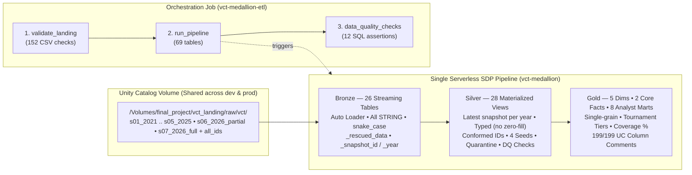

# VCT Databricks Lakehouse Pipeline (2021–2026)

An end-to-end, production-style **Databricks Lakehouse** data engineering project built on the Kaggle **Valorant Champions Tour (2021–2026)** dataset (~1.36 GB, 131 CSVs, ~27,450 games scraped from `vlr.gg`).

It implements a complete **Medallion Architecture** (Landing → Bronze → Silver → Gold) using **Lakeflow Spark Declarative Pipelines (SDP)**, **Lakeflow Jobs**, **Unity Catalog**, **Declarative Automation Bundles (DABs)**, and **GitHub Actions CI/CD** — engineered to run cleanly on **Databricks Free Edition** (serverless compute only).

> **How to use this README:** This document is written as a complete, top-to-bottom walkthrough. If you read it in order — and open each file in the **Guided Review Sequence** below — you will understand every table, script, workflow, and architectural decision in the project.

---

## 1. The Problem & What Was Built

Real-world esports data is messy. Profiling the 131 raw CSVs exposed problems that break naive ETL pipelines:
- **No IDs in fact files:** Fact CSVs contain only display names (`Tournament`, `Stage`, `Match Name`, `Team`, `Player`). IDs live in separate yearly `ids/` and cross-year `all_ids/` files.
- **Cross-year identity drift:** Within one year, names map 1:1 to IDs; across years, 224 player names collide across multiple IDs and 15 players + 5 teams renamed themselves.
- **Ambiguous keys & missing IDs:** 23 game keys (19 in 2021, 4 in 2022) map to two distinct Game IDs; ~410 players in 2021 have no source Player ID; `"Mega Minors"` and `"Kiwoom DRX"` have unverified/missing IDs.
- **Mixed grains in the same CSV:** `"All Maps"` match rollups and `"All Stages"` / `"All Match Types"` tournament rollups sit beside detail rows — summing them silently double-counts every stat.
- **Meaningful NULLs & partial coverage:** China-hosted matches (e.g., Masters Shanghai 2024), ~38% of 2021 Challengers games, and 2025 Stage 2/Champions `eco_rounds` lack stats; `Loadout Value` is empty from Masters Toronto 2025 onward; one real player is literally named `"nan"`.
- **Full-snapshot monthly refreshes:** Kaggle republishes full-year CSVs monthly, so Silver must **replace** a year's slice from the latest snapshot rather than append.

### End-to-End Architecture



### Verified Production Results (`final_project.vct_bronze` / `vct_silver` / `vct_gold`)
- **Bronze:** 26 streaming tables, **152 / 152** table-snapshot row counts matched local CSVs exactly, **0** rescued rows.
- **Silver:** 28 materialized views + 2 private DQ checks; **100.00%** 2025 `eco_rounds` resolution (after tournament alias seed), **99.77–100.00%** game resolution, **0** rows leaked from `s06_2026_partial`, **0** typing parse failures, literal player `"nan"` (`10207`) preserved.
- **Gold:** 15 materialized views (5 conformed dimensions, 2 core facts, 8 analyst marts), **199 / 199** Unity Catalog column comments populated.
- **Job (`vct-medallion-etl`):** Ran end-to-end on both `dev` and `prod` with **12 / 12** SQL quality assertions passing.

---

## 2. Guided File Review Sequence (Start Here)

Review the repository in this exact order. Each step builds directly on the previous one.

---

### Step 1 — Understand the Raw Data First
| # | File | Purpose |
|---|---|---|
| 1 | [docs/data_profile_summary.md](docs/data_profile_summary.md) | Summarizes every empirical quirk found across all 131 CSVs (identity drift, mixed grains, 2025 `eco_rounds` renames, mirrored round outcomes, verified highlight-only `rounds_kills`, documented vs. undocumented stat gaps). |

**Why start here?** Every downstream engineering choice — from `snake_case` in Bronze to surrogate keys, quarantine tables, and `*_coverage_pct` columns in Gold — exists because of a specific fact documented in this file.

---

### Step 2 — Bundle Configuration, Environments & Tooling
| # | File | Purpose |
|---|---|---|
| 2 | [databricks.yml](databricks.yml) | Top-level Declarative Automation Bundle (DABs) definition declaring `dev` and `prod` targets, shared `landing_schema`, `env_prefix` (`dev_` vs. `""`), and `schedule_pause_status` (default `PAUSED`). |
| 3 | [resources/vct_medallion.pipeline.yml](resources/vct_medallion.pipeline.yml) | Defines the single serverless triggered SDP pipeline (`vct-medallion`), sets `root_path: ../src`, injects `vct.landing_root`, `vct.seeds_dir`, `vct.bronze_schema`, `vct.silver_schema`, `vct.gold_schema`, and lists all Bronze/Silver/Gold library files. |
| 4 | [pyproject.toml](pyproject.toml) | Python 3.12 project config, `pytest` `pythonpath = ["src"]`, and `ruff` linter rules (ignoring `F821` in pipeline files where Databricks injects `spark` at runtime). |

**Key decisions & why:**
- **Prefix-based environments (`dev_` vs. `""`) sharing one landing volume ([ADR 005](docs/decisions/005-prefix-based-environments.md)):** Free Edition restricts catalog/workspace creation and allows only one active pipeline per type. Sharing read-only `vct_landing.raw` while prefixing `dev_vct_bronze/silver/gold` isolates `dev` and `prod` cleanly with zero duplicated raw storage.
- **Single multi-schema pipeline:** Publishing Bronze, Silver, and Gold from one SDP DAG respects Free Edition's active-pipeline limit while giving full cross-layer lineage in one graph.
- **`vct.seeds_dir: ${workspace.file_path}/seeds`:** Databricks SDP executes pipeline files like cells where Python's `__file__` is undefined. Passing the bundle's deployed path via pipeline config keeps seeds version-controlled in Git and portable across `dev` and `prod`.
- **Default `schedule_pause_status: PAUSED`:** Guarantees deploying `prod` never activates a monthly cron schedule until the owner explicitly enables it.

---

### Step 3 — Immutable Landing Snapshots
| # | File | Purpose |
|---|---|---|
| 5 | [scripts/upload_batches.py](scripts/upload_batches.py) | CLI script to upload local VCT folders into `/Volumes/final_project/vct_landing/raw/vct/<snapshot_id>/` one snapshot at a time (`--only`, `--dry-run`). Generates synthetic 80%-row `s06_2026_partial` in a temp folder before `s07_2026_full` + `all_ids` to prove refresh semantics. |

**Key decision & why:**
- **Immutable snapshot directories ([ADR 001](docs/decisions/001-landing-snapshots.md)):** Never overwrite CSVs in place. Landing each monthly drop under `<snapshot_id>/` lets Auto Loader ingest incrementally without `allowOverwrites`, preserves full audit history in Bronze, and makes `_snapshot_id` deterministically parseable from `_metadata.file_path`.

---

### Step 4 — Bronze Layer (Raw, Lossless Auto Loader Ingestion)
| # | File | Purpose |
|---|---|---|
| 6 | [src/pipelines/bronze/bronze_config.py](src/pipelines/bronze/bronze_config.py) | **Pure-Python** (zero PySpark imports) `to_snake`, `snake_names` (with collision guard + `_rescued_data` preservation), and the declarative 26-table `BRONZE_TABLES` registry (21 yearly + 5 `all_ids`). |
| 7 | [src/pipelines/bronze/bronze.py](src/pipelines/bronze/bronze.py) | Config-driven SDP pipeline looping over `BRONZE_TABLES` to register 26 Auto Loader streaming tables (`cloudFiles`, `csv`), renaming headers to `snake_case`, and extracting `_source_file`, `_file_modified_at`, `_ingested_at`, `_snapshot_id`, and `_year`. |
| 8 | [tests/conftest.py](tests/conftest.py) | Pytest configuration refactored to load Databricks Connect **lazily** only when a test requests the `spark` fixture. |
| 9 | [tests/test_bronze_naming.py](tests/test_bronze_naming.py) | 14 pure-Python unit tests verifying tricky VCT headers (`"Kill, Assist, Trade, Survive %"`), collision detection, `_rescued_data` preservation, and the 26-table registry (runs in 0.05s with no Spark). |
| 10 | [scripts/reconcile_bronze.py](scripts/reconcile_bronze.py) | Queries all 26 Bronze tables via `/api/2.0/sql/statements` and compares every `(table, _snapshot_id)` row count against local CSVs + verifies 0 non-null `_rescued_data`. |

**Key decisions & why:**
- **All `STRING` + `schemaEvolutionMode=rescue` ([ADR 002](docs/decisions/002-bronze-rescue-mode.md)):** Prevents Spark from turning literal player `"nan"` into `NULL` or failing on formatted strings (`"80%"`, `"0.3k"`), while capturing any future upstream column drift in `_rescued_data`.
- **Explicit all-`STRING` schema on the 5 `all_ids` tables:** Auto Loader cannot infer CSV headers from an empty glob during `s01`–`s06` (before `s07_2026_full` uploads `all_ids/`). Providing an explicit string schema including `_rescued_data STRING` lets those 5 tables initialize cleanly with 0 rows and auto-ingest when `s07` arrives.
- **Rename headers to `snake_case` in Bronze ([ADR 003](docs/decisions/003-rename-in-bronze.md)):** Delta rejects raw headers containing `%`, commas, and parentheses. Normalizing headers in Bronze (while never altering cell values) avoids Delta column-mapping friction downstream.
- **Separate pure-Python config + lazy `conftest.py`:** Lets `pytest` run in <0.1s locally and in GitHub Actions PR CI without Databricks credentials or spinning up serverless compute.

---

### Step 5 — Version-Controlled Domain Seeds
| # | File | Purpose |
|---|---|---|
| 11 | [seeds/tournament_alias.csv](seeds/tournament_alias.csv) | Maps 2025 `eco_rounds` legacy names (`Champions Tour 2025: ...` → `VCT 2025: ...` + manual `Masters Bangkok` alias). |
| 12 | [seeds/team_alias.csv](seeds/team_alias.csv) | Tracks manual team identity exceptions (`Mega Minors` → `3788` marked `unverified`; `Kiwoom DRX` marked `unresolved`). |
| 13 | [seeds/agent_release.csv](seeds/agent_release.csv) | All 29 Valorant agents with `first_seen_year` verified from Bronze `matches_overview` and `release_date_verified` flag. |
| 14 | [seeds/tournament_tier.csv](seeds/tournament_tier.csv) | Ordered regex rules classifying tournaments into `International_Champions`, `International_Masters`, `Regional_LCQ`, `Challengers_Qualifier`, `Regional_League`, and `Other`. |

**Key decision & why:**
- **Seeds in Git instead of hardcoded `CASE WHEN` chains ([ADR 007](docs/decisions/007-alias-and-reference-seeds.md)):** Domain exceptions are reviewable in PRs, auditable in Git history, and explicitly flag unverified/unresolved mappings rather than hiding assumptions in code.

---

### Step 6 — Silver Layer (Typed, Conformed, Quarantined, Verified)
| # | File | Purpose |
|---|---|---|
| 15 | [src/pipelines/silver/silver_transforms.py](src/pipelines/silver/silver_transforms.py) | Reusable PySpark helpers: `latest_snapshot_by_year`, `latest_snapshot_global`, ANSI-safe regex-guarded casts (`parse_int`, `parse_double`, `parse_pct`, `parse_credits`, `parse_duration_sec`, `parse_ratio_won`/`played`), deterministic `surrogate_key`, `documented_gap_reason_expr`, and canonical 4-value `win_loss_method` enum. |
| 16 | [src/pipelines/silver/silver_seeds.py](src/pipelines/silver/silver_seeds.py) | Reads `seeds/*.csv` from `vct.seeds_dir` into `${vct.silver_schema}.seed_*` materialized views. |
| 17 | [src/pipelines/silver/silver_dimensions.py](src/pipelines/silver/silver_dimensions.py) | Builds 6 conformed dimensions (`dim_tournament`, `dim_stage_match_type`, `dim_team`, `dim_player`, `dim_agent`, `dim_map`), 4 yearly name→ID lookup tables, and `quarantine_ambiguous_games` (19 keys in 2021 + 4 in 2022). |
| 18 | [src/pipelines/silver/silver_facts_matches.py](src/pipelines/silver/silver_facts_matches.py) | Builds 11 single-grain match/map/round facts: `fct_match`, `fct_map_game` (with data-presence `has_performance_stats` & `has_economy_stats`), `fct_player_map_stats`, `fct_player_match_rollup_stats` (separated `"All Maps"`), `fct_player_map_performance`, `fct_economy_round`, `fct_economy_summary` (wide pivot), `fct_kill_pair` (All/First/Op pivot), `fct_round_outcome` (canonical enum), `fct_draft`, and `fct_highlight_round_kill` (documented as multi-kill/clutch highlights only). |
| 19 | [src/pipelines/silver/silver_facts_aggregates.py](src/pipelines/silver/silver_facts_aggregates.py) | Builds 4 rollup-flagged aggregate facts (`fct_agent_pick_rate`, `fct_agent_map_side_stats`, `fct_agent_team_pick`, `fct_player_tournament_stats`), unified `quarantine_silver_records`, and 2 private DQ expectation MVs (`dq_silver_dimension_uniqueness`, `dq_silver_fk_integrity`). |
| 20 | [scripts/reconcile_silver.py](scripts/reconcile_silver.py) | Standalone SQL assertion script verifying 0 `s06_2026_partial` rows, 0 typing failures, literal `"nan"` preservation, and `>= 99.5%` game resolution rates. |

**Key decisions & why:**
- **Materialized Views + `max(_snapshot_id)` per year ([ADR 004](docs/decisions/004-replace-latest-snapshot-silver.md)):** Full-snapshot monthly CSVs cannot be appended without duplicating rows. Filtering to the latest snapshot per year in MVs gives clean replace-year-slice semantics automatically.
- **ANSI-safe regex-guarded casts (no zero-fill):** Serverless Spark runs in ANSI mode (and doesn't expose `F.try_cast` on `pyspark.sql.functions`). Regex-guarded casts preserve meaningful `NULL`s, never crash on malformed text, and allow `quarantine_silver_records` to audit parse failures explicitly.
- **Yearly name resolution + cross-year ID conformance:** Joining on `(year, name)` via yearly `ids_*` respects the 1:1 yearly invariant while conforming on `player_id`/`team_id` across seasons preserves rename history.
- **Enriching `match_type_id` from `all_ids`:** Yearly `ids_tournament_stage_matches_games` omits `match_type_id` and lags facts; joining `dim_stage_match_type` (sourced from `all_ids`) gives complete match-type coverage.
- **Separating rollups & quarantining ambiguous games ([ADR 006](docs/decisions/006-rollup-flags-and-single-grain.md)):** Left-anti-joining `quarantine_ambiguous_games` prevents 2x join fan-out; isolating `"All Maps"` rows prevents double-counting.

---

### Step 7 — Gold Layer (Analyst-Ready Star Schema & 8 Marts)
| # | File | Purpose |
|---|---|---|
| 21 | [src/pipelines/gold/gold_utils.py](src/pipelines/gold/gold_utils.py) | Pure helper `col_doc(expr, name, comment)` attaching Unity Catalog column comments via Spark metadata. |
| 22 | [src/pipelines/gold/gold_dimensions.py](src/pipelines/gold/gold_dimensions.py) | 5 conformed Gold dimensions (`dim_tournament`, `dim_team` with `alias_status`, `dim_player`, `dim_agent`, `dim_map`). |
| 23 | [src/pipelines/gold/gold_facts.py](src/pipelines/gold/gold_facts.py) | 2 single-grain core facts: `fct_game_scores` (1 row per map) and `fct_player_game_stats` (1 row per game-player, `side = 'both'`, non-rollup only). |
| 24 | [src/pipelines/gold/gold_marts.py](src/pipelines/gold/gold_marts.py) | 8 analyst-ready marts: `match_results_base`, `player_career_summary`, `player_season_form`, `team_results_timeline`, `team_map_pool_winrate`, `agent_meta_by_tournament`, `map_side_balance`, `economy_efficiency_by_team`. |
| 25 | [docs/data_dictionary.md](docs/data_dictionary.md) | Complete Gold schema reference: table grains, primary keys, columns, and analytical guardrails. |

**Key decisions & why:**
- **Dedicated `gold_utils.py` instead of cross-importing pipeline files:** Importing a helper from another SDP library file evaluates top-level `spark.conf.get(...)` outside SDP's cell context (`NameError: spark`). Keeping shared helpers in pure non-pipeline modules is a core SDP best practice.
- **Coverage columns beside every average (`rating_coverage_pct`, `duration_coverage_pct`, `economy_coverage_pct`):** Averages ignore `NULL`s, so without a coverage ratio an analyst cannot distinguish a 100%-covered stat from a China-hosted or 2021 Challengers partial sample.
- **Computing `agent_meta_by_tournament` from `fct_player_game_stats` + `first_seen_year`:** `vlr.gg`'s raw `agents_pick_rates.csv` emits `0%` rows for unreleased agents in earlier years (e.g., `clove` in 2021). Computing `times_picked / (2 * games_played)` from actual non-rollup games and filtering `year >= agent.first_seen_year` eliminates pre-release noise.
- **199 / 199 UC column comments via Spark metadata:** Every Gold table and column is self-documenting in Unity Catalog Explorer without maintaining duplicate DDL scripts.

---

### Step 8 — Orchestration Job & Cross-Layer Quality Gates
| # | File | Purpose |
|---|---|---|
| 26 | [resources/vct_medallion.job.yml](resources/vct_medallion.job.yml) | 3-task serverless Lakeflow Job (`vct-medallion-etl`): `validate_landing` → `run_pipeline` → `data_quality_checks`, `max_concurrent_runs: 1`, monthly cron schedule (`0 0 6 1 * ?`, UTC, paused by default). |
| 27 | [src/jobs/validate_landing.py](src/jobs/validate_landing.py) | Serverless pre-flight check verifying all expected yearly and `all_ids` CSVs exist and are non-empty in `/Volumes/...` before starting the pipeline. |
| 28 | [src/jobs/data_quality_checks.py](src/jobs/data_quality_checks.py) | Serverless post-flight Spark SQL suite running 12 cross-layer assertions across Bronze, Silver, and Gold and failing the job if any check fails. |

**Key decisions & why:**
- **Fail-fast pre-check + post-pipeline job gate:** In triggered SDP pipelines, a failing private expectation MV rolls back only its own flow rather than failing the whole pipeline. Wrapping the pipeline between `validate_landing` and `data_quality_checks` guarantees the job fails loudly on missing landing files, rescued rows, partial-snapshot leaks, or Gold invariant breaches.
- **Linear 3-task serverless DAG:** Uses 1 active task at a time (well within Free Edition's 5-task concurrency cap) with serverless `environment_key: default` (`client: "2"`).

---

### Step 9 — CI/CD, ADRs & Engineering Retrospective
| # | File | Purpose |
|---|---|---|
| 29 | [.github/workflows/ci.yml](.github/workflows/ci.yml) | PR workflow: installs Python 3.12 + `ruff` + `pytest`, runs lint, unit tests, and `databricks bundle validate -t dev`. |
| 30 | [.github/workflows/deploy.yml](.github/workflows/deploy.yml) | Main-branch merge workflow behind a protected `production` GitHub Environment (manual reviewer approval): runs `bundle validate -t prod` and `bundle deploy -t prod`. |
| 31 | [docs/decisions/](docs/decisions/) | 7 focused Architecture Decision Records (`001`–`007`) documenting context, decision, consequences, and rejected alternatives. |
| 32 | [docs/learning-log.md](docs/learning-log.md) | Chronological log of real Databricks serverless/SDP runtime discoveries encountered and solved during implementation. |

**Key decision & why:**
- **Short-lived PAT for Free Edition CI/CD with documented OIDC upgrade path:** Verified via `databricks tokens list` that Free Edition supports PATs (`DATABRICKS_HOST` + `DATABRICKS_TOKEN` in GitHub Secrets), whereas the absence of an Account Console blocks OAuth M2M / OIDC federation setup. Both workflows document switching to `DATABRICKS_CLIENT_ID` + GitHub OIDC on Enterprise workspaces.

---

## 3. Quick Start: Run & Query

### Local Checks (No Databricks Compute Needed)
```powershell
.\.venv\Scripts\ruff.exe check src tests scripts
.\.venv\Scripts\pytest.exe -v
```

### Deploy & Run in Databricks (`dev` or `prod`)
```powershell
# Dev (writes to final_project.dev_vct_bronze / dev_vct_silver / dev_vct_gold)
databricks bundle validate -t dev --profile dev
databricks bundle deploy -t dev --profile dev
databricks bundle run vct_medallion_job -t dev --profile dev

# Prod (writes to final_project.vct_bronze / vct_silver / vct_gold; schedule stays PAUSED)
databricks bundle validate -t prod --profile dev
databricks bundle deploy -t prod --profile dev
databricks bundle run vct_medallion_job -t prod --profile dev
```

### Sample Gold SQL Queries (Databricks SQL Editor)
```sql
-- Top career players (min 150 maps) with rating coverage
SELECT canonical_player_name, games_played, rating_coverage_pct,
       avg_rating, avg_acs, career_kd_ratio, most_played_agent
FROM final_project.vct_gold.player_career_summary
WHERE games_played >= 150
ORDER BY avg_rating DESC
LIMIT 20;

-- International agent meta (excludes pre-release seasons)
SELECT year, tournament_name, map_name, agent, games_played, pick_rate
FROM final_project.vct_gold.agent_meta_by_tournament
WHERE tournament_tier IN ('International_Champions', 'International_Masters')
  AND year >= 2024
ORDER BY year DESC, pick_rate DESC
LIMIT 25;
```
