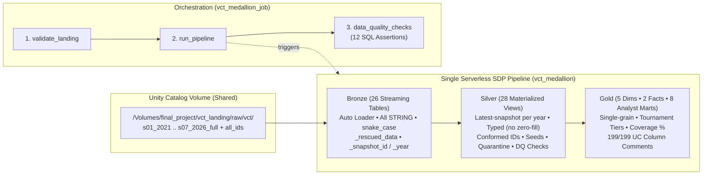

# VCT Databricks Lakehouse Pipeline (2021–2026)

End-to-end, portfolio-grade Databricks data engineering project built on the Kaggle **Valorant Champions Tour (2021–2026)** dataset (~1.36 GB, 131 CSVs, ~27,450 games scraped from `vlr.gg`). Implements a full **Medallion Architecture** (Landing → Bronze → Silver → Gold) using **Lakeflow Spark Declarative Pipelines (SDP)**, **Lakeflow Jobs**, **Unity Catalog**, **Declarative Automation Bundles (DABs)**, and **GitHub Actions CI/CD** — engineered to run cleanly on **Databricks Free Edition** (serverless compute).

---

## Architecture



---

## Key Engineering Highlights
- **Incremental Auto Loader Ingestion (26 Bronze tables):** Config-driven loop over 21 yearly CSV types and 5 cross-year `all_ids` files. Verified **152/152** table-snapshot row counts match local CSVs with **0 mismatches** and **0 rescued rows**.
- **Replace-Year-Slice Semantics:** Monthly Kaggle refreshes ship full-year CSVs; Silver keeps `max(_snapshot_id)` per `_year` (proven via synthetic 80% `s06_2026_partial` → `s07_2026_full` refresh with 0 partial rows remaining).
- **Conformed Identity & Quarantine:** Resolves names to source IDs within each year, preserves cross-year rename history, assigns deterministic surrogate keys (`SK_PLAYER_*` / `SK_TEAM_*`) with `has_source_id = false` for ID-less entities, preserves literal player `"nan"`, and quarantines 23 ambiguous game keys (19 in 2021, 4 in 2022) to prevent join fan-out.
- **Honest Analytics (Gold):** Never zero-fills missing stats (China-hosted tournaments, 2021 Challengers, 2025 Stage 2/Champions `eco_rounds`, post-Toronto Loadout Value). Every average ignores `NULL`s and ships with a `*_coverage_pct` column and `tournament_tier`.
- **Single-Pipeline Multi-Schema Deployment:** Publishes across `vct_bronze`, `vct_silver`, and `vct_gold` (prefixed `dev_` in `dev`) from one serverless pipeline to respect Free Edition limits.

---

## Repository Structure

```text
vct_pipeline/
├── databricks.yml                      # DABs bundle config (dev & prod targets)
├── pyproject.toml                      # Python 3.12, pytest, ruff config
├── resources/
│   ├── vct_medallion.pipeline.yml      # 69-table Bronze/Silver/Gold SDP pipeline
│   └── vct_medallion.job.yml           # 3-task serverless orchestration job
├── seeds/                              # Version-controlled reference CSVs
│   ├── tournament_alias.csv
│   ├── team_alias.csv
│   ├── agent_release.csv
│   └── tournament_tier.csv
├── src/
│   ├── pipelines/
│   │   ├── bronze/                     # bronze_config.py + bronze.py (26 tables)
│   │   ├── silver/                     # seeds, dimensions, facts, quarantine, DQ
│   │   └── gold/                       # star schema + 8 analyst marts
│   └── jobs/                           # validate_landing.py + data_quality_checks.py
├── scripts/                            # upload_batches.py, reconcile_bronze.py, reconcile_silver.py
├── tests/                              # Pure-Python unit tests + lazy DB Connect fixture
├── docs/
│   ├── data_dictionary.md              # Full Gold schema & mart reference
│   ├── data_profile_summary.md         # Empirical profiling findings
│   ├── learning-log.md                 # Engineering notes & runtime lessons
│   └── decisions/                      # 7 Architecture Decision Records (ADRs)
└── .github/workflows/
    ├── ci.yml                          # PR: ruff + pytest + bundle validate -t dev
    └── deploy.yml                      # Main merge: manual-approval prod deploy
```

---

## How to Run (Dev Target)

### 1. Local lint & unit tests (no Databricks compute required)
```powershell
.\.venv\Scripts\ruff.exe check src tests scripts
.\.venv\Scripts\pytest.exe -v
```

### 2. Upload snapshots to Unity Catalog Volume
```powershell
# Dry-run any snapshot
.\.venv\Scripts\python.exe scripts\upload_batches.py --data-root "D:\DATABRICKS PROJECT" --only s06_2026_partial --dry-run --profile dev

# Upload one snapshot at a time
.\.venv\Scripts\python.exe scripts\upload_batches.py --data-root "D:\DATABRICKS PROJECT" --only s02_2022 --profile dev
```

### 3. Validate, deploy, and run end-to-end on `dev`
```powershell
databricks bundle validate -t dev --profile dev
databricks bundle deploy -t dev --profile dev
databricks bundle run vct_medallion_job -t dev --profile dev
```

### 4. Reconcile Bronze & Silver
```powershell
.\.venv\Scripts\python.exe scripts\reconcile_bronze.py --data-root "D:\DATABRICKS PROJECT" --profile dev
.\.venv\Scripts\python.exe scripts\reconcile_silver.py --profile dev
```

---

## Documentation Index
- [Gold Data Dictionary](docs/data_dictionary.md)
- [Data Profile Summary](docs/data_profile_summary.md)
- [Engineering Learning Log](docs/learning-log.md)
- [Architecture Decision Records (ADRs)](docs/decisions/)
